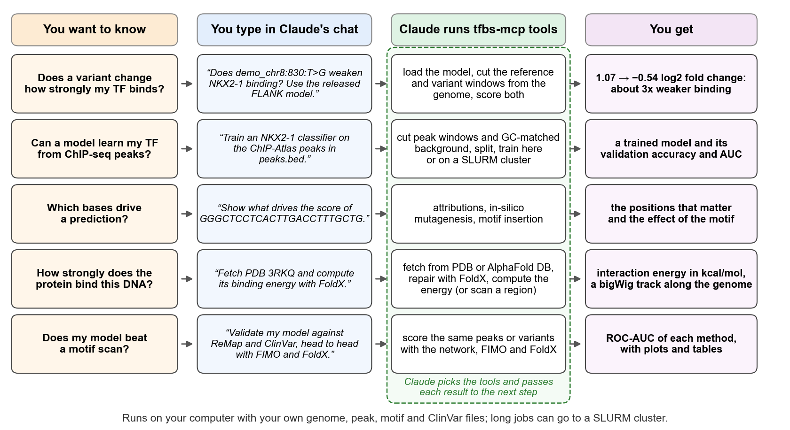

# tfbs-mcp

tfbs-mcp lets you analyse transcription factor (TF) binding sites by asking Claude in plain language. Ask whether a variant weakens binding, train a binding-site model on your ChIP-seq peaks, see which bases a model relies on, compute the binding energy of a TF-DNA crystal structure, or test a model against ReMap peaks and ClinVar variants, head to head with motif scanning (FIMO) and structure-based energy (FoldX). Claude chooses the steps, runs them on your computer (or on a SLURM cluster) and answers with the numbers.



*Figure 1. Five typical questions. You type the question into Claude's chat; Claude chains the tfbs-mcp tools on your own files and answers with the result. Each question has its own section under [What do you want to do?](#what-do-you-want-to-do)*

## What you can do

| I want to ... | Besides the install I need | Go to |
|---|---|---|
| try it without downloading anything | nothing | [Try it with the bundled example](#try-it-with-the-bundled-example) |
| score sequences or ChIP-seq peaks with the published NKX2-1 model | the released models (30 MB); a genome for peaks | [Score sequences or peaks](#score-sequences-or-peaks-with-the-released-nkx2-1-models) |
| find out whether a variant changes binding | a model and a genome | [Check what a variant does](#check-what-a-variant-does) |
| get ROC-AUC and PR-AUC for scores from any tool | nothing | [Compute classification metrics](#compute-classification-metrics-for-your-own-scores) |
| train a binding-site classifier on my ChIP-seq peaks | a peak BED and a genome; a SLURM cluster for large sets | [Train your own classifier](#train-your-own-classifier-from-chip-seq-peaks) |
| see which bases drive a prediction, or which motifs a model learned | a model | [Understand what a model learned](#understand-what-a-model-learned) |
| scan sequences for a known motif | a motif file | [Scan sequences for a motif](#scan-sequences-for-a-motif) |
| get my TF's structure on DNA and its binding energy | FoldX, internet | [Structure-based binding energy](#compute-structure-based-binding-energy) |
| test my model on ReMap peaks against FIMO and FoldX | a trained model, ReMap BED, genome, motif, MEME Suite, FoldX | [Validate against ReMap](#validate-a-model-against-remap) |
| test whether my model separates pathogenic from benign ClinVar variants | a trained model, ClinVar, peaks, genome; Linux, macOS or WSL | [Check ClinVar variants](#check-clinvar-disease-variants-in-your-tfs-peaks) |
| compare my model's scores on the peaks of several TFs | ChIP-Atlas intersection files, genome, trained model | [Benchmark on ChIP-Atlas](#benchmark-against-other-tfs-on-chip-atlas) |
| run the long jobs on an HPC cluster | SLURM | [Run on a SLURM cluster](#run-on-a-slurm-cluster) |

[Get the data with Claude's help](#get-the-data-with-claudes-help) downloads the genome, peaks, motif, ClinVar and the released models with one prompt.

**An example.** With the bundled demo registered and the released models downloaded, you type:

> Load the released NKX2-1 FLANK model \<models>/flank/vcnnbpnet.pt (model type VCNNBpnet) and tell me whether the variant demo_chr8:830:T>G weakens NKX2-1 binding. Compare the 24 bp reference and variant windows centred on it, cut from the registered genome.

Claude answers along these lines: *Yes. The predicted binding falls from 1.07 to -0.54 log2 fold change, a loss of 1.6, so binding at the variant site is predicted to be about 3 times weaker. The change turns the CAAG core of the motif (read on the minus strand) into CACG.* To get there it loaded the model, cut the reference and variant windows from the demo genome, scored both and compared them. To run this yourself: install (below), run `tfbs-mcp --setup --demo` ([details](#try-it-with-the-bundled-example)), download the released models ([link](#score-sequences-or-peaks-with-the-released-nkx2-1-models)), then paste the prompt with your models folder in place of `<models>`.

## Installation

Setup takes about 20 minutes, most of it waiting for PyTorch to download. The commands are written for Linux. macOS uses the same commands. Windows differs in a few places, described in [docs/install-windows.md](docs/install-windows.md).

### What you need

1. **Claude Code or Claude Desktop.** The server adds tools to Claude, so you need one of the two:
   - **Claude Code** runs in a terminal. It needs a paid Claude plan (Pro, Max, Team or Enterprise) or an Anthropic Console account. Install it by following the Claude Code quickstart at <https://code.claude.com/docs/en/quickstart>.
   - **Claude Desktop** is the Claude app with a window. Download it from <https://claude.com/download>.

   Other AI apps work too, but are not covered here. See [docs/other-clients.md](docs/other-clients.md).
2. **Python 3.10 to 3.13**, provided by an environment manager. We recommend micromamba, which installs Python for you: follow its install guide at <https://mamba.readthedocs.io/en/latest/installation/micromamba-installation.html>. If a Python in that range is already installed, its built-in `venv` module works too: <https://docs.python.org/3/library/venv.html>.
3. **git**, because the install command fetches the package from GitHub. Install it with your package manager (for example `sudo apt install git`), or inside the environment with `micromamba install -c conda-forge git`.
4. **About 3 GB of free disk space**, mostly for PyTorch.
5. **A GPU is optional.** Everything runs on the CPU. A CUDA GPU is used automatically when one is present.

### Step 1: Create an environment

An environment is a private folder for this project's Python packages, so the install cannot break anything else on your computer. With micromamba:

```bash
micromamba create -n tfbs-mcp python=3.13 -c conda-forge
micromamba activate tfbs-mcp
```

Your prompt now starts with `(tfbs-mcp)`, which means the environment is active. In a new terminal window, run the `micromamba activate` line again before using `pip` or `tfbs-mcp`. If `micromamba activate` instead says the shell is not initialised, run the `micromamba shell init` command it suggests, open a new terminal, and run the activate line again.

With venv instead (Python 3.10 to 3.13 must already be installed):

```bash
python3 -m venv ~/tfbs-env
source ~/tfbs-env/bin/activate
```

Here the prompt starts with `(tfbs-env)`, and the `source` line is the one to repeat in a new terminal.

### Step 2: Install and check

```bash
pip install "tfbs-mcp[mcp,genomics,viz] @ git+https://github.com/sproft/tfbs-mcp.git"
```

This downloads PyTorch, roughly 2 to 3 GB, and can take 5 to 20 minutes. It is not stuck. Then check the installation:

```bash
tfbs-mcp --check
```

A working install ends like this (the paths will be your own):

```
  [ok  ] Python 3.13.12
  [ok  ] server loads, 33 tools registered
  [ok  ] PyTorch 2.14.0
  ...
  [note] wandb not installed: tfbs_sweep needs it (pip install "tfbs-mcp[tracking]")
  [ok  ] executable: /home/you/micromamba/envs/tfbs-mcp/bin/tfbs-mcp

Everything needed is installed. Connect the server with ONE of these:
```

If a line says `FAIL`, it also says how to fix it. A `note` line names an optional extra that one tool needs; you can add it later with the `pip install` command shown. The command then prints the exact setup text for step 3, with the path to your installation filled in.

### Step 3: Connect Claude

**Claude Code.** With the environment still active, run:

```bash
claude mcp add tfbs --scope user -- "$(which tfbs-mcp)"
```

This does the same as the `claude mcp add` line that `tfbs-mcp --check` printed. Then `claude mcp list` should list `tfbs` with a connected status; inside a Claude Code session, `/mcp` shows the same.

**Claude Desktop.** Open **Settings > Developer > Edit Config**. This opens `claude_desktop_config.json`, and creates it if it does not exist yet. Paste the block that `tfbs-mcp --check` printed; it looks like this:

```json
{
  "mcpServers": {
    "tfbs": {
      "command": "/home/you/micromamba/envs/tfbs-mcp/bin/tfbs-mcp",
      "args": []
    }
  }
}
```

Use the block from `--check` rather than this example, because it contains your real path. If the file already contains `"mcpServers"`, add only the `"tfbs": {...}` entry inside it, with a comma after the previous entry. Save, then quit Claude Desktop completely (closing the window is not enough) and open it again. You never start the server by hand: from now on, Claude starts it in the background whenever it needs a tool.

### Step 4: Test it

Start Claude: `claude` in the terminal for Claude Code, or open the Claude Desktop app. Type the following line into Claude's chat, the box where you normally write to Claude. It is a message for Claude, not a shell command; pasted into the terminal, the shell answers with something like `Command 'Check' not found`.

> Check the TFBS server environment. Is it running on SLURM, does it see a GPU, and what models are loaded?

The reply should say: **SLURM: No** (unless you are on an HPC cluster); the **GPU count and default device**, for example 0 GPUs and device `cpu` with batch size 64 (fine: the tools work on the CPU); **Models loaded: None** (expected until you load one); and the PyTorch version. The server loads PyTorch and its other libraries when it starts, which takes about 7 to 9 seconds on a workstation (7.4 to 8.7 s measured on one Windows 10 machine with a CPU build of PyTorch); after that every call answers immediately. On a computer with an NVIDIA GPU but a CPU-only PyTorch build the device is `cpu`.

### Step 5: First things to try

These need nothing but the install. Type them into Claude's chat.

> My tool scored five known binding sites 0.9, 0.8, 0.7, 0.6 and 0.55, and five non-sites 0.3, 0.2, 0.4, 0.1 and 0.65. How well does it separate them? Give ROC-AUC and PR-AUC.

Claude reports ROC-AUC 0.92 and PR-AUC 0.92: the one non-site at 0.65 outscores two sites. This works for scores from any tool, see [Compute classification metrics](#compute-classification-metrics-for-your-own-scores).

> Download PDB entry 3RKQ, an NKX2-5 homeodomain bound to DNA, from RCSB and tell me where the file was saved.

Claude downloads the crystal structure into `<results>/structures/3RKQ/`, where `<results>` is the server's `results_dir` (Claude can tell you which), and says that it contains DNA. This needs internet access. With FoldX installed, [the structure task](#compute-structure-based-binding-energy) computes its binding energy.

> Turn AAACACTTGAGGCAAA and TTTGCCTCAAGTGTTT into the one-hot format the models read, with their reverse complements.

Claude writes a tensor of 4 sequences (the two inputs and their reverse complements) of 16 positions each and says where it is. You need this only to feed sequences to your own scripts or training runs; the scoring tools encode sequences themselves.

Setup is complete. Pick a task from [What you can do](#what-you-can-do). A tool that fails answers with `{"error": "...", "fix": "..."}` rather than crashing; ask Claude to show the raw tool response if an answer looks wrong. Problems and their fixes: [docs/troubleshooting.md](docs/troubleshooting.md) (the most common, `tfbs` showing a red X or `failed` in `/mcp`, means the server crashed at startup: run `tfbs-mcp --check` and fix its `FAIL` line). Windows: [docs/install-windows.md](docs/install-windows.md).

## What do you want to do?

Each task says what you need, what to type into Claude's chat, what happens and what you get. Replace the parts in `<angle brackets>` with your own paths. A genome, motif or ClinVar file you registered (see [Registering your data](#registering-your-data)) need not be named in the prompt; a path in the prompt always wins. A loaded model stays loaded until Claude restarts the server, so later prompts can refer to it by its name. The tool names in parentheses are only for reference ([all tools](docs/tools.md)).

### Try it with the bundled example

- **You need:** nothing beyond the install. The package ships a 10 kb slice of chromosome 8 around the thyroglobulin promoter (a classic NKX2-1 target), the JASPAR `MA1994.1` NKX2-1 motif and `demo_peaks.bed`, four NKX2-1 sites in the slice. Register the genome and motif once, in one of two ways:
  - **In your own terminal**, with the environment active: `tfbs-mcp --setup --demo`. It asks for the other paths (press Enter to skip each), offers to register with Claude Code when the `claude` command is on your PATH, and prints the path of `demo_peaks.bed`.
  - **Through Claude Code**, which cannot answer setup's questions itself. Say: *Run `tfbs-mcp --setup --demo --non-interactive`, replace my Claude Code registration of tfbs with the `claude mcp add` command it prints, and tell me the path of demo_peaks.bed.*

  Then restart Claude Code (`/exit`, then `claude`). For Claude Desktop, replace the `tfbs` entry in its config with the printed block, then quit and reopen the app. If the path was not printed, `python -c "from tfbs.mcp.cli import demo_dir; print(demo_dir())"` prints the demo folder.
- **Say to Claude:**
  > Extract 200 bp sequences around every peak in \<the demo_peaks.bed path> and tell me how many were extracted. Then scan GGGCTCCTCACTTGACCTTTGCTG, the centre of the second peak, for the NKX2-1 motif with FIMO.
- **What happens:** Claude cuts a 200 bp window around each peak from the demo genome and encodes it (`tfbs_extract_loci`), then scans the sequence with the registered motif (`tfbs_fimo`), using the MEME Suite's `fimo` program when it is installed and tangermeme's FIMO reimplementation otherwise.
- **You get:** 4 windows in `sequences.pt`, with `regions.bed` and `scores.pt` (the motif scores from column 5 of the BED), and one FIMO hit: `CTCACTTGACCTT` on the plus strand, positions 7 to 19, p = 4e-5. It contains the NKX2-1 core `CACTTGA` and lies about 4.2 kb upstream of the thyroglobulin start. Next, download the released models and ask the [example question](#what-you-can-do) above.

### Get the data with Claude's help

- **You need:** Claude Code and about 5 GB of disk. The downloads run in Claude Code's own shell, not in tfbs-mcp; Claude Desktop cannot run shell commands, so there you download the files from the links under [Registering your data](#registering-your-data). FoldX needs a licence registration, so you always download it yourself.
- **Say to Claude:**
  > Download into <~/tfbs-data>: hg38.fa.gz from UCSC (then gunzip it); the ChIP-Atlas NKX2-1 peaks https://chip-atlas.dbcls.jp/data/hg38/assembled/Oth.ALL.10.NKX2-1.AllCell.bed without its first (track) line; the JASPAR motif https://jaspar.elixir.no/api/v1/matrix/MA1994.1.meme; the GRCh38 clinvar.vcf.gz from NCBI with its .tbi index; and the released NKX2-1 models https://zenodo.org/api/records/21399578/files/sproft/nkx2-1-tfbs-variants-v1.0.0.zip/content, unzipped. Then run `tfbs-mcp --setup --non-interactive` with `--genome`, `--motif` and `--clinvar` set to those files, replace my Claude Code registration of `tfbs` with the `claude mcp add` command it prints, and tell me where the models are.

  For the ReMap check, add *and the ReMap 2022 NKX2-1 peaks https://remap.univ-amu.fr/storage/remap2022/hg38/MACS2/TF/NKX2-1/remap2022_NKX2-1_nr_macs2_hg38_v1_0.bed.gz, gunzipped*. The ChIP-Atlas file holds the peaks of all NKX2-1 experiments at MACS2 q < 1e-10 (`10`); `05` and `20` in the name give 1e-5 and 1e-20.
- **What happens:** Claude downloads and unpacks the files with its shell, runs `tfbs-mcp --setup --non-interactive` (which asks nothing and only prints), then `claude mcp remove tfbs --scope user` and the printed `claude mcp add` line. Claude's shell finds `tfbs-mcp` only if you started `claude` with the environment active; otherwise give it the path that `tfbs-mcp --check` prints.
- **You get:** `hg38.fa`, the peak BED, `MA1994.1.meme`, `clinvar.vcf.gz` with its `.tbi`, and the models folder, with the first three registered as `TFBS_GENOME_FASTA`, `TFBS_MOTIF_FILE` and `TFBS_CLINVAR_VCF`. Restart Claude Code so the server starts with them. Each setup run replaces the whole registration, see [Registering your data](#registering-your-data).

### Score sequences or peaks with the released NKX2-1 models

- **You need:** the NKX2-1 study's released checkpoints (doi:10.5281/zenodo.21399578, <https://doi.org/10.5281/zenodo.21399578>): download `nkx2-1-tfbs-variants-v1.0.0.zip` (30 MB) and unzip it, or let Claude do it (previous section). Its `models/` folder holds `core/`, `flank/` and `all/`, each with a `vcnnbpnet.pt`. They load directly with `tfbs_load_model` and model type `VCNNBpnet`, their label scaling included. The three were trained on EMSA-seq libraries of an NKX2-1 site in its thyroglobulin-promoter context that vary the 4 bp core (CORE), the 10 bp flanks (FLANK) or all 14 bp (ALL); FLANK generalises best and is the one the study recommends. Scoring peaks also needs a registered genome.
- **Say to Claude:**
  > Load the released NKX2-1 model \<models>/flank/vcnnbpnet.pt as "flank" (model type VCNNBpnet) and score these 24 bp sequences: GGGCTCCTCACTTGACCTTTGCTG, <more 24 bp sequences>.

  > Cut 24 bp windows centred on every peak in <peaks.bed> from the registered genome and score them all with the flank model.

  For a model you trained, say *Load my checkpoint <path/to/best_VCNNBpnet.ckpt> as "mine" (model type VCNNBpnet)* and score with "mine".
- **What happens:** Claude loads the model with its scaling (`tfbs_load_model`) and scores the sequences (`tfbs_predict`). For a BED it first cuts the 24 bp windows from the genome (`tfbs_extract_loci`). The models score 24 bp, the length of the library construct they were trained on (6 + 14 + 4 bp); to find the best site inside wider peaks, ask for 200 bp windows scored in sliding-window mode.
- **You get:** one score per sequence, in input order (for a BED, in the order of `regions.bed` in the extraction folder). The released models score in log2 fold change of EMSA-seq enrichment: higher means stronger predicted binding, and a difference of 1 is a 2-fold difference. On the four demo peaks FLANK gives 1.96, 1.39, 2.61 and -0.69. A classifier you trained scores from 0 (no site) to 1 (site).

### Check what a variant does

- **You need:** a model loaded as above and a registered genome of the same build as the variant. A variant is written `chrom:pos:REF>ALT` with a 1-based position.
- **Say to Claude:**
  > With the flank model, score the variant demo_chr8:830:T>G: extract the 24 bp reference and alternative windows centred on it from the registered genome and compare their scores.
- **What happens:** Claude cuts the reference window from the genome, checks that the genome base equals REF, builds the variant window, scores both and subtracts (`tfbs_extract_loci` with `variants`, `tfbs_predict` twice).
- **You get:** two scores and their difference, with `ref_sequences.pt`, `alt_sequences.pt` and `variants.json` (window coordinates and sequences). With the demo genome this variant falls from 1.07 to -0.54, a loss of 1.6 log2 fold change. A REF that does not match the genome, usually a different genome build, is listed under `ref_mismatches` instead of being scored.

### Compute classification metrics for your own scores

- **You need:** scores for known positives and known negatives, from tfbs-mcp or any other tool.
- **Say to Claude:**
  > Compute ROC-AUC and PR-AUC for a method that scored the positives <0.9, 0.8, ...> and the negatives <0.3, 0.2, ...>.

  In Claude Code you can name a file instead (*the scores in <scores.tsv>, column 2, with the label in column 3*); Claude reads it and passes the two lists.
- **What happens:** Claude passes both lists to `tfbs_classify_metrics`. When there are more negatives than positives, it draws as many negatives as positives at random, so both classes weigh the same; say "use all negatives" to keep them all.
- **You get:** ROC-AUC, PR-AUC, the two counts, and the points of both curves.

### Train your own classifier from ChIP-seq peaks

- **You need:** a BED of ChIP-seq peaks for your TF (ChIP-Atlas) and a registered genome. A laptop is enough for a few thousand windows (add "use at most 5000 peaks" to subsample a large file); larger sets go to a SLURM cluster.
- **Say to Claude:**
  > Train an NKX2-1 binding-site classifier on the ChIP-Atlas peaks in <peaks.bed>. Use 24 bp windows centred on the peaks as positives and GC-matched genomic windows from the registered reference genome as negatives. Build the train, validation and test split, write the training config for the VCNNBpnet architecture, and train it here on this computer. Report the numbers of positives and negatives, the split sizes, the validation metrics and the checkpoint.

  GC-matched negatives are random genome windows with the same GC content as the peaks, so the model cannot tell the classes apart by base composition alone. VCNNBpnet is the architecture of the published models; the others are listed in [docs/development.md](docs/development.md#available-model-architectures). For a cluster, replace "train it here on this computer" with "submit the training as a SLURM job on the \<partition> partition with 64 GB of memory" and follow the job as in [Run on a SLURM cluster](#run-on-a-slurm-cluster). For a model that predicts peak strength instead of yes or no, say "train a regression model on the peak signal in column 5" instead of asking for negatives.
- **What happens:** Claude cuts the windows and draws one GC-matched negative per peak (`tfbs_extract_loci`), labels positives 1 and negatives 0 (`tfbs_prepare_classification`), splits 64/16/20 into train, validation and test (`tfbs_prepare_dataset`), writes the config (`tfbs_config`) and trains, waiting at most an hour (`tfbs_train`).
- **You get:** the `<name>_loci_24bp_gc/`, `<name>_24bp_gc_classification/` and `<name>_24bp_gc_dataset/` folders next to the BED, the config, the checkpoint `saved_models/<name>_24bp_gc/none/best_VCNNBpnet.ckpt` under the project root, and the validation accuracy and AUC of the best epoch. Test-split metrics: on a cluster, ask Claude to validate the checkpoint on the test split as a SLURM job (`tfbs_validate`); without one, in Claude Code, say *Load the checkpoint as "mine", score \<dataset>/test/seqs.pt, read the labels from \<dataset>/test/labels.pt with Python, and compute ROC-AUC and PR-AUC.*

### Understand what a model learned

- **You need:** a loaded model (released or your own). For motif names, a MEME motif file such as JASPAR.
- **Say to Claude**, one question at a time:
  - *Which bases drive the score?* With the flank model, compute DeepLiftShap attributions and an in-silico mutagenesis map for GGGCTCCTCACTTGACCTTTGCTG, and list the five most important positions. (Attributions split the score among the bases by comparing with shuffled copies of the sequence; mutagenesis changes every base to each other base and records the score change.)
  - *Does the motif raise the score anywhere?* With the flank model, measure how much inserting CACTTGA into 100 random backgrounds changes the prediction.
  - *Which motifs did the model learn, and do they match JASPAR?* With the flank model, call seqlets in \<sequences> and match them against \<JASPAR.meme> with TOMTOM; also turn the first-layer filters into motifs. (Seqlets are short stretches with high attribution.)
  - *Do two positions act together?* With the flank model, compute pairwise epistasis for GGGCTCCTCACTTGACCTTTGCTG and list the strongest interactions.
- **What happens:** `tfbs_analyze` and `tfbs_mutagenesis`, `tfbs_marginalize`, `tfbs_seqlets` and `tfbs_conv_filters`, `tfbs_epistasis`, in the order of the questions.
- **You get:** a summary in Claude's reply (top positions, the mean effect of the motif in score units, matched motif names, the strongest pairs), and the full results as files in `<results>/<model id>/<tool name>/<digest>/` unless you name a folder: `attributions.pt` and `ism_scores.pt` (4 x length per sequence), `seqlets.tsv`, `filters.meme`, `epistasis_matrix.csv`. The tools draw no plots; in Claude Code, ask *Plot attributions.pt as a sequence logo with logomaker and save it as a PNG* (logomaker comes with the `viz` extra).

### Scan sequences for a motif

- **You need:** a MEME-format motif file, registered as `TFBS_MOTIF_FILE` or named in the prompt. The MEME Suite is optional here.
- **Say to Claude:**
  > Scan these sequences for the NKX2-1 motif with FIMO at p < 1e-4: <sequence 1>, <sequence 2>.
- **What happens:** Claude scans both strands with the MEME Suite's `fimo` program when it is on the PATH, otherwise with tangermeme's FIMO reimplementation (`tfbs_fimo`; `backend` in the result says which).
- **You get:** up to 500 hits in the reply, lowest p-value first, each with sequence, 1-based start and end, strand, score, p-value and matched site, and all hits in a TSV file.

### Compute structure-based binding energy

- **You need:** internet access, and FoldX, a separately licensed program. Install it once: register at <https://foldxsuite.crg.eu/> (free for academic use), unpack the download, rename the program (its name carries a date) to `foldx` (`foldx.exe` on Windows), run `chmod +x foldx` on Linux and macOS, and move it into the folder of the `tfbs-mcp` executable that `tfbs-mcp --check` prints. Claude Code started in the activated environment then finds it; for Claude Desktop see the FoldX row of [docs/troubleshooting.md](docs/troubleshooting.md). Check it with the first prompt below. The genome scan also needs the `foldx` extra (`pip install "tfbs-mcp[foldx]"`) and a genome FASTA.
- **Say to Claude:**
  > Find an experimental structure of NKX2-1 bound to DNA and tell me its protein and DNA chains.

  > Fetch PDB entry <3RKQ> and compute its protein-DNA binding energy with FoldX, repairing it first, with protein chain <A> and DNA chains <C,D>. Then scan <chr:start-end> of the genome <hg38.fa> with the repaired structure, with a step of 5 bp, and give me the bigWig.
- **What happens:** Claude searches the PDB for entries with protein and DNA, or downloads the one you name (`tfbs_fetch_structure`); an AlphaFold DB model is the fallback but has no DNA and cannot be scored. Claude Code reads the chain IDs from the downloaded file; in Claude Desktop, the entry's page on rcsb.org lists them (3RKQ: protein A and B, DNA C and D, the defaults). FoldX then repairs the structure and computes the protein-DNA interaction energy (`tfbs_binding_energy`). The scan places each genome window's sequence on the structure's DNA and scores it (`tfbs_binding_scan`); the scan does not use registered files, so its prompt always names the genome and the repaired structure. A FoldX run takes minutes, so keep the region short or add "as a SLURM job".
- **You get:** the repaired `<id>_Repair.pdb` (the file to register as `TFBS_FOLDX_PDB`), the interaction energy and its parts in kcal/mol, and a bigWig with the lowest energy per window. More negative means stronger binding.

### Validate a model against ReMap

- **You need:** a model you trained (a `.ckpt`, see [Train your own classifier](#train-your-own-classifier-from-chip-seq-peaks)); the released `.pt` models cannot be used here. Also the ReMap 2022 non-redundant BED for your TF (<https://remap.univ-amu.fr/>; experiment count in column 5), the MEME Suite's `fimo` program on the PATH (no fallback here; on Windows this needs WSL, see [docs/install-windows.md](docs/install-windows.md)), FoldX with a repaired PDB, and a registered genome and motif.
- **Say to Claude:**
  > Validate the checkpoint <path/to/best_VCNNBpnet.ckpt> against ReMap 2022: use the NKX2-1 peaks in <remap.bed> (experiment count in column 5) with dinucleotide-shuffled negatives, and compare it head to head with FIMO and FoldX using the registered motif, structure and genome, writing to \<project>/results/remap_nkx2-1. Run it directly rather than as a SLURM job, score this checkpoint and not the study's saved models, and report the ROC-AUC of each method with the numbers of positives and negatives.
- **What happens:** Claude runs `tfbs_remap_validation`: up to 500 peaks seen in at least 4 experiments are the positives, shuffled copies of them (same dinucleotide content, motifs destroyed) the negatives. The network scores the best 24 bp stretch of each region, FIMO scans the region and FoldX scores its 11 bp centre. Without "run it directly" it becomes a SLURM job; Claude then reports a job ID, and later you ask it to read `summary.csv`. Add "skip FoldX" for a quick run.
- **You get:** `summary.csv`, two score tables and `roc_all_methods.png` in the output folder; when run directly, the reply holds the ROC-AUC of each method with the numbers of positives and negatives.

### Check ClinVar disease variants in your TF's peaks

- **You need:** a model you trained (a `.ckpt`; the released `.pt` models cannot be used here), the indexed ClinVar VCF (`clinvar.vcf.gz` with its `.tbi`), a peak BED and a registered genome; optionally a motif (with the `fimo` program) and a repaired PDB. Linux, macOS or WSL, because pysam has no Windows wheel.
- **Say to Claude:**
  > Run the ClinVar disease-variant check on the peaks in <peaks.bed> with the registered ClinVar file, motif and genome, scoring the checkpoint <path/to/best_VCNNBpnet.ckpt> as "my_model", writing to \<project>/results/clinvar_nkx2-1. Report for each method the ROC-AUC for separating pathogenic from benign variants, with the variant counts.
- **What happens:** Claude runs `tfbs_disease_variant_validation`: it takes the non-coding pathogenic and benign single-base ClinVar variants inside the peaks, scores both alleles with your model, with FIMO and with FoldX (when a structure is registered), and tests whether the size of the change separates pathogenic from benign. Always name the checkpoint; without it no network is scored. It runs directly unless you ask for a SLURM job.
- **You get:** `summary_all_methods.csv` and plots in the output folder, and per method in the reply: `auc_abs` (ROC-AUC of the size of the change, ignoring its direction), `auc_raw` (the same with the signed change), `mwu_p` (Mann-Whitney U p-value for the size of the change) and the counts `n_path` and `n_benign`. A method with fewer than 10 scored variants, or with only pathogenic or only benign ones, has no row.

### Benchmark against other TFs on ChIP-Atlas

- **You need:** a folder with one intersection file per TF, named `<TF>.allintersect.bed`: the output of `bedtools multiinter -header` over that TF's per-experiment ChIP-Atlas peak files (a header line, then chrom, start, end, the number of experiments, ...). Also a registered genome and a `.ckpt` you trained. The method comparison also needs a motif, the `fimo` program (WSL on Windows), FoldX and a repaired PDB.
- **Say to Claude:**
  > Benchmark the checkpoint <path/to/best_VCNNBpnet.ckpt> as "my_model" on the ChIP-Atlas intersection files in \<folder>: NKX2-1 as the positive TF against GATA1, MYOD1, NKX2-5 and RXRA, writing to \<project>/results/chipseq_benchmark.
- **What happens:** Claude scores the peaks of every TF and asks whether the score separates NKX2-1 peaks from each other TF's peaks, at experiment-count cutoffs 1, 3, 5 and 8, and whether it rises with the number of experiments (`tfbs_chipseq_benchmark`). Ask for "the head-to-head comparison with FIMO and FoldX" to run the same task on 500 peaks per TF with all three methods (`tfbs_chipseq_method_comparison`), as a SLURM job by default, because FoldX makes it take hours.
- **You get:** `classification_cutoff_results.csv`, `classification_vs_negatives.csv`, `regression_results.csv` and ROC and regression plots; the comparison writes `auc_summary.csv`, `auc_pivot.csv` and `roc_by_neg_tf.png`.

### Run on a SLURM cluster

- **You need:** Claude Code started on a machine where `sbatch`, `squeue` and `sacct` work, such as a login node; `fimo` and FoldX on a filesystem the compute nodes see. GPU jobs go to the partition named in the prompt, else to the registered default, else to `gpu`. To register a default, together with the [other variables](#registering-your-data) of your registration, run `claude mcp remove tfbs --scope user`, then `claude mcp add tfbs --scope user --env TFBS_SLURM_PARTITION=<gpu partition> TFBS_GENOME_FASTA=<hg38.fa> -- "$(which tfbs-mcp)"`. If your cluster requires an account, add `SBATCH_ACCOUNT=<account>` to that `--env` list; `sbatch` reads it from the environment.
- **Say to Claude:**
  > Train an NKX2-1 binding-site classifier on the ChIP-Atlas peaks in <peaks.bed> with 24 bp windows and GC-matched negatives from the registered genome, using the VCNNBpnet architecture, and submit the training as a SLURM job on the \<partition> partition with 64 GB of memory. Report the job ID.

  > How is job \<job id> doing? If it has finished, show me the end of its log.
- **What happens:** Claude prepares the data on the machine where Claude Code runs and submits the training (`tfbs_train`), then asks the scheduler about the job (`slurm_status`) and reads its log (`slurm_logs`). Claude does not check back by itself: ask again later. `tfbs_validate`, `tfbs_sweep` (with `wandb login`) and the validation tools submit jobs the same way, and Claude can cancel a job.
- **You get:** the job ID, then its state, elapsed time and exit code, and the last 100 lines of the error log. If a job failed, ask "Why did the job fail?" and Claude reads the log.

## Registering your data

Each input is optional; register the ones your tasks need, so prompts need not name them. Register in one of two ways:

- **In your own terminal**, with the environment active: `tfbs-mcp --setup`. It asks for each path (Enter skips one; a path that does not exist is asked again), prints the Claude Code command and the Claude Desktop block with your paths filled in, and, when the `claude` command is on your PATH, asks `Register with Claude Code now? [y/N]`. For Claude Desktop, replace the `tfbs` entry in **Settings > Developer > Edit Config** with the printed block, then quit and reopen the app.
- **Through Claude Code**, for files already on your disk. Say: *Register my files with tfbs: genome \</path/hg38.fa>, motif \</path/MA1994.1.meme>. Run `tfbs-mcp --setup --non-interactive` with those flags, replace the tfbs registration with the `claude mcp add` command it prints, and tell me to restart.*

**Each run replaces the whole registration** with the paths given in that run, so name every path again, e.g. `--genome ... --motif ... --clinvar ... --foldx-pdb ...`, and add any variable you set by hand (such as `TFBS_SLURM_PARTITION`) again. `claude mcp get tfbs` shows what is registered now. Restart Claude Code (`/exit`, then `claude`) after a change.

| Input | Used by | Where to get it | Variable |
|---|---|---|---|
| Reference genome FASTA, uncompressed (hg38 is about 3 GB) | extraction, negatives, variants, benchmarks and validation | UCSC: <https://hgdownload.soe.ucsc.edu/goldenPath/hg38/bigZips/hg38.fa.gz>, then `gunzip hg38.fa.gz`. Chromosome names in your BED files must match the FASTA (NCBI's GRCh38 names chromosome 8 `NC_000008.11`, not `chr8`) | `TFBS_GENOME_FASTA` |
| ChIP-seq peaks (BED) | extraction and training | ChIP-Atlas: <https://chip-atlas.org/> | none; name the file in your prompt |
| MEME-format motif | `tfbs_fimo` and the FIMO legs | JASPAR `MA1994.1` (NKX2-1): <https://jaspar.elixir.no/api/v1/matrix/MA1994.1.meme> (CC BY 4.0). The validation pipelines also need the MEME Suite's `fimo`: <https://meme-suite.org/meme/doc/download.html> | `TFBS_MOTIF_FILE` |
| Repaired TF-DNA complex PDB | the FoldX legs | the PDB from `tfbs_fetch_structure`, repaired by `tfbs_binding_energy` ([FoldX](#compute-structure-based-binding-energy)) | `TFBS_FOLDX_PDB` |
| Indexed ClinVar VCF | `tfbs_disease_variant_validation` | NCBI, GRCh38: <https://ftp.ncbi.nlm.nih.gov/pub/clinvar/vcf_GRCh38/clinvar.vcf.gz> (about 200 MB) and <https://ftp.ncbi.nlm.nih.gov/pub/clinvar/vcf_GRCh38/clinvar.vcf.gz.tbi>, side by side | `TFBS_CLINVAR_VCF` |
| Model checkpoint | prediction and interpretation | the released NKX2-1 models (doi:10.5281/zenodo.21399578), or one you train | none; name it in your prompt |
| Project directory | training, benchmark and validation tools | any directory; it holds `data/`, `saved_models/` and `results/` ([details](docs/development.md#where-the-tools-find-checkpoints)). Unset: the repository root in a clone, else the server's working directory | `TFBS_PROJECT_ROOT` |

Flags prefill answers, so you are not asked for those variables: `--genome PATH`, `--motif PATH`, `--clinvar PATH`, `--foldx-pdb PATH`, `--project-root PATH`. A prefilled path is still checked. `--demo` prefills `--genome` and `--motif` with the bundled example data. `--non-interactive` asks nothing: it uses only the flags, never offers to register, and just prints both forms. For example:

```bash
tfbs-mcp --setup --genome /data/hg38/hg38.fa --motif /data/JASPAR/MA1994.1.meme --non-interactive
```

Then run `claude mcp remove tfbs --scope user` and the printed `claude mcp add` line. Claude Code keeps the variables in the user-scope `tfbs` entry of `~/.claude.json` (do not edit that file by hand), Claude Desktop in the `env` block of the `tfbs` entry.

### By hand

This is what `--setup` writes. For Claude Code, first `claude mcp remove tfbs --scope user` (adding a name that already exists is an error), then `claude mcp add tfbs --scope user --env TFBS_GENOME_FASTA=/data/hg38/hg38.fa TFBS_MOTIF_FILE=/data/JASPAR/MA1994.1.meme -- "$(which tfbs-mcp)"`. For Claude Desktop, add to the `tfbs` entry of the config file, after `"args": []` and a comma: `"env": {"TFBS_GENOME_FASTA": "/data/hg38/hg38.fa", "TFBS_MOTIF_FILE": "/data/JASPAR/MA1994.1.meme"}`. On Windows, see [docs/install-windows.md](docs/install-windows.md) for the PowerShell form of these commands.

Two more variables are optional and not asked by `--setup`; add them to the `--env` list or the `env` block the same way:

| Variable | What it does |
|---|---|
| `TFBS_SLURM_PARTITION` | default partition of the GPU jobs (`tfbs_train`, `tfbs_validate`, `tfbs_sweep`, the benchmark and ReMap tools); unset, `gpu`. `tfbs_server_info` reports it as `default_partition` |
| `TFBS_CALL_LOG` | path of a JSON Lines file. When set, every tool call appends one line after it returns, holding the arguments and the result: `timestamp` (start of the call, UTC), `tool`, `arguments` as received, `seconds` (wall time), `is_error` and `result` (the tool's JSON answer; one larger than 1 MB is stored as its size and first 4096 characters). A call that fails is logged too. Unset, nothing is written. `tfbs_server_info` reports the file in use as `call_log` |

## Uninstall

Remove the server from Claude Code with `claude mcp remove tfbs --scope user`. For Claude Desktop, open **Settings > Developer > Edit Config**, delete the `"tfbs": {...}` entry from `"mcpServers"` (and the comma that separated it from a neighbouring entry), save, then quit and reopen the app.

Remove the package with `pip uninstall tfbs-mcp`, or remove the whole environment instead. With micromamba, run `micromamba deactivate` first, because an active environment cannot be removed, then `micromamba env remove -n tfbs-mcp`. With venv, delete the folder: `rm -rf ~/tfbs-env`. Finally, delete the data files you downloaded (the genome, motif, ClinVar, model and PDB files) if you no longer need them. Structures fetched by `tfbs_fetch_structure` without an output folder are in `<results>/structures/<id>/`, where `<results>` is the `results_dir` that `tfbs_server_info` reports; the repaired copies that `tfbs_binding_energy` keeps are saved there too.

## Further documentation

[docs/tools.md](docs/tools.md) lists all 33 tools in their six layers, with the architecture diagram. [docs/install-windows.md](docs/install-windows.md) covers the Windows differences and the tools that need WSL, [docs/troubleshooting.md](docs/troubleshooting.md) symptoms, causes and fixes, [docs/other-clients.md](docs/other-clients.md) AI apps other than Claude, and [docs/development.md](docs/development.md) the Python library, the training and prediction commands, running the server by hand, the optional extras, the model architectures, the project structure and the test suite.

## Citation

If you use `tfbs-mcp` in your work, please cite:

> Proft S, Leser U. tfbs-mcp: a Model Context Protocol server for agentic transcription factor binding site analysis. *Bioinformatics*, 2026 (in preparation).

## License

MIT. See [LICENSE](LICENSE) for details.
