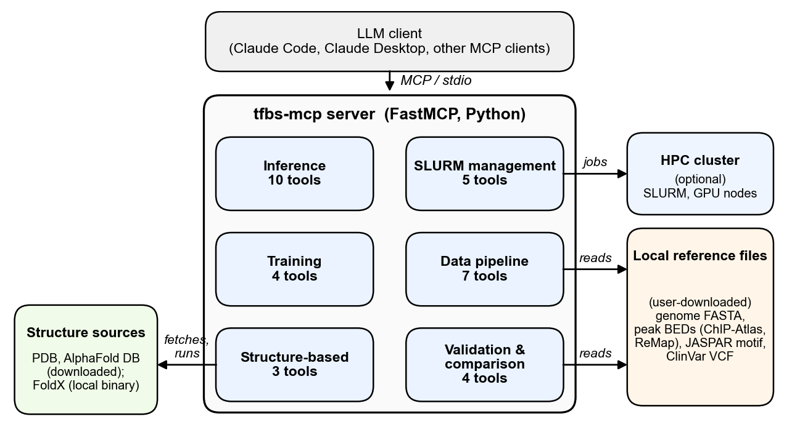

# All 33 tools

This page is a reference. To find out what you can do with the tools, start from [What you can do](../README.md#what-you-can-do) in the README.

*The LLM client (Claude Code, Claude Desktop or another MCP client) starts the server and calls its tools over MCP. The tools read your local reference files, fetch structures from the PDB or AlphaFold DB, run FoldX, and submit jobs to an optional SLURM cluster.*

The tfbs-mcp server registers 33 tools in six layers. Each line below is the first sentence of the tool's own description, the text Claude reads when it chooses a tool; the full description, with every argument and its default, is the docstring in `tfbs/mcp/server.py` (or `tfbs/mcp/foldx_tools.py` for the structure-based layer), and an MCP client shows it as the tool's description. The last column points to the README task that uses the tool.

## Inference (10 tools)

Load models, score sequences, explain predictions and scan for motifs.

| Tool | What it does | Used in |
|---|---|---|
| `tfbs_load_model` | Load a trained TFBS model checkpoint into the server's memory. | [Score sequences or peaks with the released NKX2-1 models](../README.md#score-sequences-or-peaks-with-the-released-nkx2-1-models) |
| `tfbs_predict` | Score DNA sequences for transcription-factor binding affinity. | [Score sequences or peaks with the released NKX2-1 models](../README.md#score-sequences-or-peaks-with-the-released-nkx2-1-models) |
| `tfbs_preprocess` | One-hot encode DNA sequences and optionally add reverse complements. | [Step 5: First things to try](../README.md#step-5-first-things-to-try) |
| `tfbs_analyze` | Run attribution analysis to identify important sequence positions. | [Understand what a model learned](../README.md#understand-what-a-model-learned) |
| `tfbs_mutagenesis` | Run in-silico saturation mutagenesis (ISM) on DNA sequences. | [Understand what a model learned](../README.md#understand-what-a-model-learned) |
| `tfbs_marginalize` | Measure the marginal effect of inserting a motif into sequences. | [Understand what a model learned](../README.md#understand-what-a-model-learned) |
| `tfbs_classify_metrics` | Compute ROC-AUC and PR-AUC from positive and negative score lists. | [Compute classification metrics for your own scores](../README.md#compute-classification-metrics-for-your-own-scores) |
| `tfbs_fimo` | Run FIMO motif scanning on DNA sequences. | [Scan sequences for a motif](../README.md#scan-sequences-for-a-motif) |
| `tfbs_list_models` | List all TFBS models currently loaded in the server. | [Step 4: Test it](../README.md#step-4-test-it) |
| `tfbs_server_info` | Show the server's runtime environment, defaults and registered reference files. | [Step 4: Test it](../README.md#step-4-test-it) |

## SLURM management (5 tools)

Submit, follow and cancel jobs on an HPC cluster.

| Tool | What it does | Used in |
|---|---|---|
| `slurm_submit` | Submit a batch job to the SLURM scheduler via sbatch. | [Run on a SLURM cluster](../README.md#run-on-a-slurm-cluster) |
| `slurm_status` | Check the current state of a SLURM job. | [Run on a SLURM cluster](../README.md#run-on-a-slurm-cluster) |
| `slurm_logs` | Read stdout and/or stderr log files for a SLURM job. | [Run on a SLURM cluster](../README.md#run-on-a-slurm-cluster) |
| `slurm_cancel` | Cancel a running or pending SLURM job. | [Run on a SLURM cluster](../README.md#run-on-a-slurm-cluster) |
| `slurm_watch` | Request monitoring of a SLURM job. | [Run on a SLURM cluster](../README.md#run-on-a-slurm-cluster) |

## Training (4 tools)

Write a training config and train, sweep or test a model.

| Tool | What it does | Used in |
|---|---|---|
| `tfbs_config` | Generate a LightningCLI YAML config file for training. | [Train your own classifier from ChIP-seq peaks](../README.md#train-your-own-classifier-from-chip-seq-peaks) |
| `tfbs_train` | Train a TFBS model: submit a SLURM job, or train on this machine. | [Train your own classifier from ChIP-seq peaks](../README.md#train-your-own-classifier-from-chip-seq-peaks) |
| `tfbs_sweep` | Create a WandB sweep and submit an agent job to SLURM. | [Run on a SLURM cluster](../README.md#run-on-a-slurm-cluster) |
| `tfbs_validate` | Submit a model validation job to SLURM. | [Train your own classifier from ChIP-seq peaks](../README.md#train-your-own-classifier-from-chip-seq-peaks) |

## Data pipeline (7 tools)

Turn peaks and variants into training data, and read motifs out of a trained model.

| Tool | What it does | Used in |
|---|---|---|
| `tfbs_extract_loci` | Extract one-hot DNA windows from a reference genome: BED peaks, matched negatives for them, and ref/alt windows around variants. | [Train your own classifier from ChIP-seq peaks](../README.md#train-your-own-classifier-from-chip-seq-peaks) |
| `tfbs_prepare_dataset` | Split sequences and labels into train/val/test directories. | [Train your own classifier from ChIP-seq peaks](../README.md#train-your-own-classifier-from-chip-seq-peaks) |
| `tfbs_prepare_classification` | Combine positive and negative sequence tensors into a binary dataset. | [Train your own classifier from ChIP-seq peaks](../README.md#train-your-own-classifier-from-chip-seq-peaks) |
| `tfbs_prepare_regression` | Prepare a regression dataset from sequences and continuous scores. | [Train your own classifier from ChIP-seq peaks](../README.md#train-your-own-classifier-from-chip-seq-peaks) |
| `tfbs_seqlets` | Call seqlets (high-attribution spans) in DNA sequences. | [Understand what a model learned](../README.md#understand-what-a-model-learned) |
| `tfbs_epistasis` | Compute pairwise epistasis scores for a DNA sequence. | [Understand what a model learned](../README.md#understand-what-a-model-learned) |
| `tfbs_conv_filters` | Summarise what the convolutional filters learned. | [Understand what a model learned](../README.md#understand-what-a-model-learned) |

## Structure-based (3 tools)

Fetch TF-DNA structures and score binding energy with FoldX.

| Tool | What it does | Used in |
|---|---|---|
| `tfbs_fetch_structure` | Retrieve a TF-DNA complex structure, trying each source given in turn. | [Compute structure-based binding energy](../README.md#compute-structure-based-binding-energy) |
| `tfbs_binding_energy` | Compute TF-DNA binding energy with FoldX AnalyseComplex. | [Compute structure-based binding energy](../README.md#compute-structure-based-binding-energy) |
| `tfbs_binding_scan` | Slide a window across a genomic region and score TF binding with FoldX. | [Compute structure-based binding energy](../README.md#compute-structure-based-binding-energy) |

## Validation and comparison (4 tools)

Test models against external peak sets and disease variants, head to head with FIMO and FoldX.

| Tool | What it does | Used in |
|---|---|---|
| `tfbs_chipseq_benchmark` | Run ChIP-seq benchmark analysis comparing NN models against ChIP-Atlas data. | [Benchmark against other TFs on ChIP-Atlas](../README.md#benchmark-against-other-tfs-on-chip-atlas) |
| `tfbs_chipseq_method_comparison` | Compare NN, FIMO (JASPAR PWM), and FoldX (TF-DNA crystal) for distinguishing positive TF peaks from negative TF peaks. | [Benchmark against other TFs on ChIP-Atlas](../README.md#benchmark-against-other-tfs-on-chip-atlas) |
| `tfbs_remap_validation` | External validation of a TFBS model against a ReMap peak set. | [Validate a model against ReMap](../README.md#validate-a-model-against-remap) |
| `tfbs_disease_variant_validation` | Validate TF-binding models against ClinVar disease variants. | [Check ClinVar disease variants in your TF's peaks](../README.md#check-clinvar-disease-variants-in-your-tfs-peaks) |
